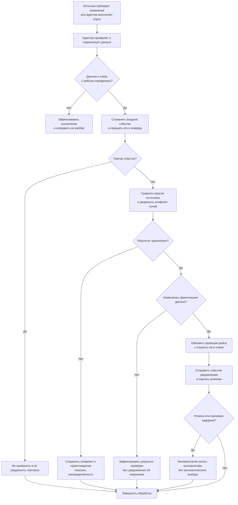
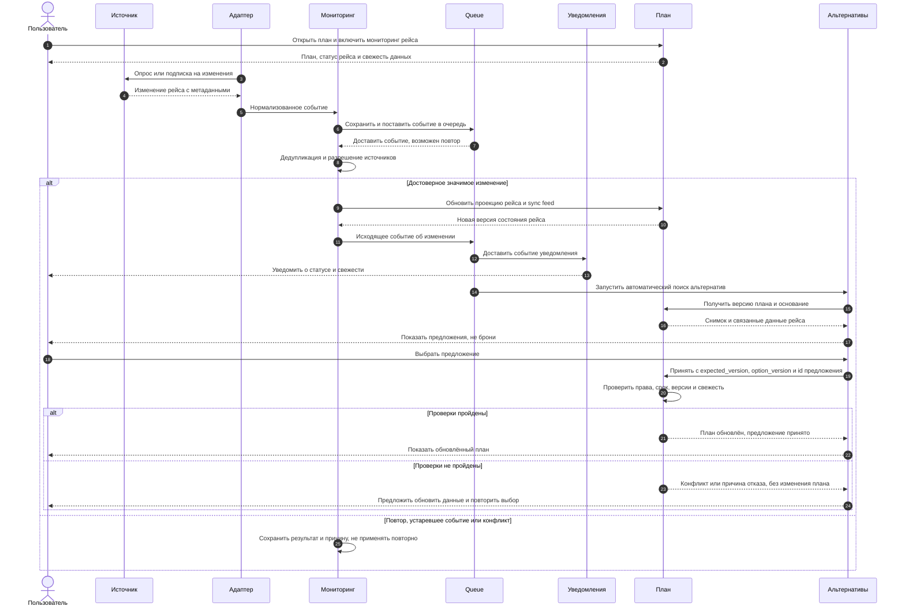
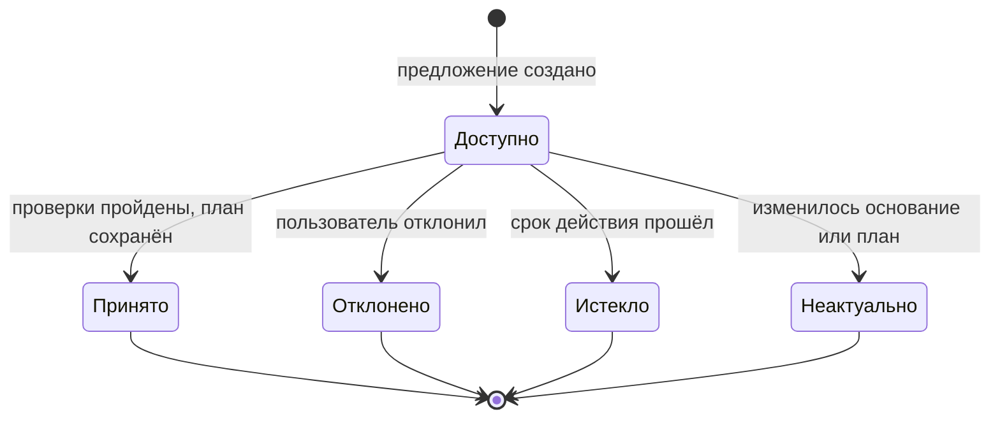

# 3. Процессные модели TravelTech

## 3.1. Назначение и границы

Документ описывает обнаружение изменений рейса, обновление плана и обработку предложений альтернатив. Источник данных сообщает сведения о рейсе; TravelTech фиксирует их происхождение и применяет к связанным элементам плана. Наличие сведений в плане не означает изменение условий у перевозчика.

!!! important "Граница v1"
    Внешние операции бронирования, перебронирования, отмены брони и оплаты не входят в v1. Принятие предложения изменяет только план TravelTech. Предложение не является бронью, билетом или гарантией доступности и цены.

| Понятие | Значение в модели |
| --- | --- |
| Рейс | Экземпляр рейса на конкретную дату и участок маршрута; не только номер рейса. Связь с элементом плана должна быть однозначной. |
| Проекция рейса в представлении плана | Сведения источника о связанном рейсе: статус, опубликованные или фактические времена и другие доступные поля с происхождением. Проекция хранится отдельно от пользовательского плана и отображается вместе с ним. |
| Пользовательская часть плана | Выбранный маршрут, заметки, участники и другие введённые пользователем данные. Изменение источника не заменяет её автоматически. |
| Версия плана `plan_version` | Серверная версия пользовательской части плана; меняется при её сохранённом изменении. Ожидаемая версия передаётся как `expected_version`. Обновление проекции рейса меняет `state_version` и запись синхронизации, но не `plan_version`. |
| Предложение | Сохранённый вариант изменения пользовательской части плана с основанием, снимком проверенных данных и сроком действия. Его принятие не вызывает внешних транзакций. |
| Очередь | Доставка событий между компонентами с возможными повторами; повторная доставка не должна повторно применять изменение или создавать повторное логическое уведомление. Фактическая доставка через внешний канал зависит от его подтверждений и поддержки идемпотентности. |

## 3.2. Обнаружение и обработка изменения

[Открыть схему в полном размере](assets/diagrams/flight-processing.png)

1. Адаптер получает сообщение по подписке или результат опроса и приводит его к общей схеме. Хранятся минимально необходимые нормализованные поля, идентификатор источника, идентификатор и версия события при наличии, идентификатор рейса, изменённые поля, время источника и время получения. Сырой ответ, который может содержать персональные данные, в мониторинге по умолчанию не сохраняется.
2. Мониторинг проверяет схему и связывает данные с экземпляром рейса и элементами планов. Неоднозначное совпадение не применяется к плану до разрешения; событие и причина сохраняются для разбора.
3. Принятое входное событие надёжно сохраняется и передаётся на обработку через очередь. Доставка допускает повтор и изменение порядка. Подтверждение сообщения очереди — после фиксации результата обработки; необработанное сообщение повторяется по настроенной политике.
4. Обработчик выполняет дедупликацию и сравнивает данные по правилам разделов 3.4–3.5. Если новое достоверное значение отличается, он обновляет проекции рейсов, связанных с поездками. Пользовательские элементы и версия плана не меняются; на чтении план объединяется с актуальной проекцией.
5. Сохранение применённого результата, отметки об обработке и исходящего события выполняется атомарно либо с эквивалентной гарантией через транзакционный outbox. Повторная доставка очереди не должна приводить к потере или дублированию внутреннего результата. Если значимых изменений нет, уведомление об изменении не создаётся. Внешняя доставка ровно один раз не гарантируется, если канал не поддерживает идемпотентность и надёжное подтверждение.

Отсутствие оснований применить новое значение не означает, что старое значение подтверждено. Неоднозначность, источник и время последнего подтверждения доступны пользователю; при отсутствии подтверждённого значения показывается «неизвестно».

## 3.3. Последовательность: изменение, уведомление, предложение

[Открыть схему в полном размере](assets/diagrams/flight-sequence.png)

Схема показывает логические взаимодействия, а не обязательное физическое размещение сервисов. Уведомление описывает именно применённое изменение либо выявленную неопределённость, не обещая получения каждого исходного сообщения. На уведомление об изменении распространяется дедупликация из раздела 3.4; при существенном неразрешённом конфликте допускается отдельное уведомление о неопределённости по тому же правилу идемпотентности.

## 3.4. Дедупликация и задержки событий

| Ситуация | Правило |
| --- | --- |
| Повтор доставки одного сообщения | При стабильном ID ключ входного события — `(source_id, source_event_id)` в реестре входных сообщений. Применение к рейсу конкретной поездки дедуплицируется отдельно по `(incoming_event_id, flight_id)`. Повтор с тем же ключом и содержимым не создаёт новое изменение или уведомление. |
| Нет стабильного идентификатора | Использовать согласованный для источника fingerprint нормализованных полей; это эвристика, способная как слить разные сообщения, так и пропустить дубликат. Область идентификатора и канонизация определяются контрактом интеграции. |
| Тот же идентификатор, но другое содержимое | Событие помещается в разбор как нарушение контракта; его нельзя молча отбросить или применить. Если поставщик повторно использует ID для ревизий, адаптер обязан сформировать уникальный нормализованный ID с учётом ревизии. |
| Разные идентификаторы, но тот же бизнес-результат | После нормализации сравниваются относящиеся к одному экземпляру рейса поля, их значения и принятое происхождение. Отсутствие значимого изменения не создаёт повторного уведомления. Подтверждённая новая проверка может обновить метаданные свежести отдельно от плана. |
| Повтор исходящего события | Идемпотентность уведомления проверяется по `(plan_id, applied_change_id, recipient_id, channel)`. Исправление, реально изменившее факты, получает новый `applied_change_id` и может вызвать новое уведомление. |
| Повтор после сбоя | Результат применения и ключ обработки сохраняются надёжно; повтор безопасен даже при сбое после записи плана, но до подтверждения очереди. Горизонт хранения ключей должен покрывать возможный срок повторной доставки и переигрывания событий; его значение подлежит согласованию. |

Для каждого события различаются `source_event_time` — время изменения, сообщённое источником, `source_as_of` — время, на которое источник подтверждает значение, и `received_at` — время приёма системой. Отсутствующее или недостоверное время помечается как неизвестное. `received_at` не доказывает, что сведения у источника новые; повтор старого сообщения не продлевает свежесть.

События одного источника упорядочиваются по его документированной монотонной версии или последовательности для данного рейса и поля. Если надёжной версии нет, время источника применяется для порядка только при гарантии его сопоставимости; иначе порядок неоднозначен. Запоздавшее старое событие сохраняется для аудита, но не откатывает более новое принятое значение. Исправление ранее присланной отмены с более новой сопоставимой версией обрабатывается как новое изменение: отмена не является необратимым состоянием. Сравнивать номера версий разных источников между собой нельзя.

## 3.5. Разрешение конфликтов источников

Правила приоритета задаются для **поля и типа источника**, а не определяются временем доставки. Система сохраняет кандидатов и происхождение: источник, значение, доступную версию, время подтверждения и причину выбора.

1. Сопоставить события только после однозначной идентификации экземпляра рейса и соответствующего поля. Неоднозначные совпадения направить на разбор.
2. Внутри каждого источника отбросить из кандидатов на применение заведомо более старые версии, сохранив их в истории. Исправление более новой версией может заменить любое прежнее значение этого источника, включая отмену.
3. Между источниками использовать согласованную таблицу приоритетов и правила допустимости данных по полю. Приоритет не делает устаревшие или непроверенные данные свежими. Менее приоритетный свежий источник не перезаписывает противоречащее значение старшего источника только из-за более позднего `received_at`; исключение возможно лишь при заранее согласованном правиле для этого поля.
4. Если приоритет или порядок не определён, источники равноправны и противоречат друг другу, либо политика не позволяет выбрать допустимое значение, зафиксировать конфликт. Последнее подтверждённое значение можно показать с его временем и предупреждением; если его нет — «неизвестно». Новое спорное значение не применяется как установленный факт.
5. После получения разрешающего обновления повторить оценку, применить подтверждённое изменение и, если изменились факты, отправить отдельное уведомление. При отсутствии конфликта актуальное подтверждение без изменения значения не является новым изменением рейса.

Таблица приоритетов источников, политика перехода на резервный источник и владелец ручного разбора должны быть согласованы до внедрения. Нельзя выводить приоритет из названия источника или считать отмену необратимой.

## 3.6. Статус рейса и свежесть данных

Статус рейса и свежесть — независимые признаки. Например, «отменён, данные устарели» не означает ни подтверждённой текущей отмены, ни автоматического возврата рейса в расписание.

| Признак | Значение и отображение |
| --- | --- |
| Статус рейса | Последнее применённое значение источника, например «по расписанию», «задержан», «отменён»; при отсутствии подтверждения — «неизвестно». Указывать источник и время, на которое значение подтверждено, если они известны. |
| Свежесть `актуально` | Есть надёжное `source_as_of`, допустимый источник и возраст подтверждения не превышает согласованный порог для поля и контекста. Это не гарантия отсутствия более нового события у поставщика. |
| Свежесть `устарело` | Время подтверждения известно, но возраст превысил порог; последнее значение сохраняется с явным предупреждением. |
| Свежесть `неизвестно` | Недостаточно данных для оценки времени или допустимости источника; нельзя называть сведения актуальными. Конфликт оценивается и отображается отдельно. |

При отсутствии согласованного порога нельзя считать данные актуальными по умолчанию. Достоверная новая проверка без изменения значения может обновить `source_as_of` и оценку свежести; получение дубликата не является такой проверкой. Если источник недоступен, система показывает последнее подтверждённое значение с возрастом либо «неизвестно», а не выдумывает новый статус.

Визовые требования и правила багажа могут отсутствовать или зависеть от гражданства, тарифа и перевозчика. При отсутствии достоверных данных отображается «неизвестно» с указанием необходимости проверки у соответствующего источника; неизвестность не равна «виза не нужна» или «багаж включён» и не превращается в утверждение при выборе альтернативы.

## 3.7. Сценарий отмены или задержки

1. Пользователь открыл план; система показывает рейс, последнее подтверждённое время и свежесть. Поступает достоверное изменение: отмена или новое время, влияющее на пересадку.
2. Мониторинг обновляет проекцию рейса, которая отображается рядом с соответствующим элементом плана. Выбранный маршрут, пользовательские заметки и остальные элементы не заменяются; отменённый рейс не удаляется автоматически. Связанные предложения переоцениваются по правилам раздела 3.8.
3. Уведомление сообщает об изменении, его источнике и времени подтверждения. Для задержки система пересчитывает пересадку по моментам UTC; если минимальное время пересадки или нужные данные неизвестны, выводится неопределённость, а не гарантия успеваемости.
4. Система автоматически ищет альтернативы рейса и затронутых активностей; пользователь также может запустить поиск вручную. Отправка уведомления об изменении не ждёт завершения поиска. Для каждой альтернативы показываются известные маршрут и времена, основание, срок действия, свежесть, а также неизвестные данные о визе и багаже. Доступность места и цена не гарантированы.
5. Принятие выбранного варианта при успешных проверках меняет только соответствующую пользовательскую часть плана. Внешней брони или оплаты не возникает. Если поставщик позднее исправит отмену или задержку, новое достоверное событие обновит проекцию рейса и может породить новое уведомление и новые предложения, но не отменит автоматически предыдущий выбор пользователя.

### 3.7.1. Пример пересадки и часовых поясов

Условный маршрут на **1 июня 2027 года**; GMT в примере используется как UTC+00:00 для представления моментов времени. Время и маршрут иллюстративные, а не расписание рейсов.

| Событие | Местное время и зона IANA | GMT / UTC |
| --- | --- | --- |
| Вылет из Стамбула | 11:00, `Europe/Istanbul`, UTC+03:00 | 08:00 |
| Плановое прибытие во Франкфурт | 13:10, `Europe/Berlin`, UTC+02:00 | 11:10 |
| Вылет следующего рейса из Франкфурта | 14:30, `Europe/Berlin`, UTC+02:00 | 12:30 |
| Новое прогнозное прибытие после задержки | 14:00, `Europe/Berlin`, UTC+02:00 | 12:00 |

Плановый интервал пересадки: `12:30 − 11:10 = 1 ч 20 мин`; после задержки: `12:30 − 12:00 = 30 мин`. Этого недостаточно для вывода, что пересадка возможна или невозможна: минимальное время пересадки, терминалы и условия перехода в примере неизвестны. При хранении нужны момент UTC, местное время, зона IANA и применённое смещение; расчёты интервалов выполняются по UTC с учётом даты. Неоднозначное или отсутствующее смещение при переходе на летнее/зимнее время нельзя угадывать: запись требует уточнения.

## 3.8. Жизненный цикл и принятие предложения

[Открыть схему в полном размере](assets/diagrams/option-lifecycle.png)

«Доступно» означает доступно для рассмотрения, а не доступно для покупки. Состояние `Неактуально` возникает, если изменились значимые для предложения данные или версия плана, либо необходимая свежесть больше не подтверждается. Истечение срока и потеря актуальности проверяются и при открытии, и непосредственно при принятии; состояние может вычисляться при обращении или обновляться фоново. Принятое предложение остаётся исторической записью даже при последующих изменениях рейса; для нового решения требуется новое предложение.

### 3.8.1. Контракт принятия

Запрос содержит `option_id`, `trip_id`, `option_version`, `expected_version` и ключ идемпотентности запроса. Предложение хранит рассчитанную при создании версию плана, срок действия, релевантные версии принятых данных рейса и описание предлагаемого изменения.

Сервер в одной транзакционной границе или с эквивалентной атомарностью:

1. Проверяет право пользователя изменять план, принадлежность предложения плану и состояние «доступно».
2. Сверяет `expected_version` с текущей `plan_version` и с версией плана, на которой построено предложение. Несовпадение — конфликт; молчаливое перезаписывание запрещено.
3. По серверному времени проверяет, что срок предложения не истёк, а релевантные версии **последних обработанных** данных не изменились и требуемая свежесть подтверждена по согласованной политике. Эти проверки не гарантируют отсутствие ещё не полученного изменения у поставщика.
4. Применяет только явно описанное изменение пользовательской части, увеличивает `plan_version` и фиксирует предложение как принятое. Проверки актуальности и запись должны быть защищены от гонки с изменением релевантных данных и плана; при несоблюдении условий ничего не записывается.
5. Возвращает обновлённый план и его версию. Повтор того же успешного запроса с тем же ключом идемпотентности возвращает сохранённый результат без повторного применения; повтор с иным содержимым и тем же ключом отклоняется.

При конфликте, истечении срока или невозможности подтвердить свежесть план не меняется. Пользователь получает причину, актуальный план при наличии соединения и возможность заново запросить предложения. После значимого обновления проекции изменяется `state_version`; прежнее предложение подлежит повторной оценке, хотя `plan_version` может остаться прежней.

## 3.9. Офлайн-доступ и совместная работа

| Ситуация | Поведение |
| --- | --- |
| Открытие без сети | Показать ранее сохранённый локально план с временем последней синхронизации. Фактические данные пометить по последней известной оценке и пересчитать возраст при наличии достоверного времени; без него свежесть неизвестна. Новых данных от источника в офлайне не обещать. |
| Действие с предложением без сети | Допустим просмотр сохранённого предложения с предупреждением. Принятие не считается выполненным и не меняет серверный план: после восстановления связи пользователь повторно открывает предложение и отправляет запрос с проверками раздела 3.8. |
| Офлайн-правка плана | В v1 не поддерживается: локальная копия доступна только для чтения. После подключения пользователь обновляет данные и выполняет изменение онлайн. |
| Два участника группы меняют один план | Первый успешный коммит увеличивает версию. Запрос второго со старой версией получает конфликт без перезаписи; показывается актуальный план для явного повторного решения. Автоматическое слияние и принцип «последняя запись побеждает» не предполагаются. |
| Одновременное принятие предложения и изменение фактов | При принятии проверяются версия плана и релевантная версия проекции. Если после проверки данные рейса изменились, транзакция не применяет устаревшее предложение. Обновление проекции не затирает пользовательский план. |

Доступ к плану, предложениям и уведомлениям ограничивается правами участника на момент операции; наличие локальной копии не подтверждает действующие права. Политики хранения и удаления офлайн-копий подлежат согласованию.

## 3.10. Исключения и восстановление

| Исключение | Обнаружение | Действие системы и результат для пользователя |
| --- | --- | --- |
| Источник недоступен, ошибка авторизации или лимит | Ошибка адаптера, тайм-аут или отказ источника | Повторять по согласованной политике; сохранить причину и время. Показывать последнее подтверждённое значение со свежестью либо «неизвестно». |
| Некорректная схема, неизвестный рейс или неоднозначное сопоставление | Ошибка валидации или несколько возможных совпадений | Не применять к плану; сохранить сообщение и направить в разбор. Не выводить неподтверждённый статус как факт. |
| Один ключ входного события с разными данными | Несовпадение содержимого по ключу дедупликации | Изолировать событие и сообщить ответственному за интеграцию; не считать его обычным повтором. |
| Запоздавшее событие или противоречие источников | Более старая версия либо отсутствие однозначного выбора | Сохранить историю; старое событие не откатывает новое. При конфликте показать предупреждение и источник последнего подтверждённого значения. |
| Сбой очереди или обработчика | Ошибка публикации, обработки или превышение лимита повторов | Повторить безопасно; после согласованного лимита направить в очередь неуспешных сообщений с возможностью разбора и повторной обработки. Не подтверждать необработанное сообщение как успешное. |
| Не доставлено уведомление | Ошибка канала | Повторить по политике канала и ключу идемпотентности. Изменение плана остаётся сохранённым; статус доставки и возможные повторы зависят от подтверждений канала. |
| Истёк срок, изменился план или данные предложения | Проверка при открытии или принятии | Не применять; показать причину и предложить повторный поиск. Бронь при этом не создаётся. |
| Нет права на изменение или право отозвано | Проверка авторизации на сервере | Отклонить запрос без изменения плана; локальные данные не являются подтверждением права. |
| Неизвестны виза, багаж, терминал или минимальное время пересадки | Отсутствуют достоверные исходные сведения | Явно показать неизвестность; не обещать допуск, багаж или успешную пересадку. |
| Неоднозначное локальное время | Нет достоверной зоны/смещения или время попадает в неоднозначный интервал | Не вычислять якобы точный момент и пересадку; запросить уточнение у источника или пользователя. |

## 3.11. Нефункциональные параметры к согласованию

Численные пороги в этом документе не установлены и не являются SLA. До реализации и запуска необходимо согласовать владельца, значение, область применения и способ измерения каждого параметра.

| Параметр | Что измерять или определить |
| --- | --- |
| Задержка обнаружения | Время от доступности изменения у источника до приёма системой; отдельно для подписки и опроса. |
| Задержка обработки | Время от `received_at` до фиксации фактического изменения в плане; учитывать повторы и хвост распределения. |
| Задержка уведомления | Время от фиксации изменения до отправки и, если канал подтверждает, до доставки; указать канал и процентили. |
| Свежесть | Максимальный возраст `source_as_of` по полю, источнику и сценарию, в том числе при принятии предложения; порядок действий при неизвестном времени. |
| Доставка и повторы | Политика backoff, число попыток, срок хранения очереди и неуспешных сообщений, условия повторной обработки, мониторинг потерь. |
| Дедупликация | Срок хранения входных и исходящих ключей относительно максимального периода повторов и переигрывания; договорённости об идентификаторах и версиях источников. |
| Конфликты и качество данных | Приоритеты по полям, допустимость резервного источника, порядок и время разбора, мониторинг неоднозначных сопоставлений. |
| Предложения и синхронизация | Срок действия, необходимые данные и их свежесть, срок хранения ключа идемпотентности и локального черновика; допустимость офлайн-хранения. |
| Безопасность и аудит | Права участников и получателей уведомлений, сроки хранения событий и истории изменений, защита и удаление локальных копий. |
