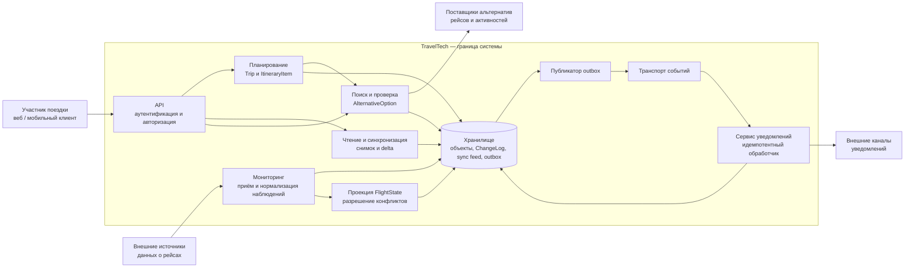

# 4. Архитектура и API

!!! warning "Черновик контракта и допущения"
    Это проектное описание TravelTech, а не документация существующего API или подтверждение доступности интеграций. Имена методов, поля, роли, статусы и примеры ниже предложены для согласования. Даты, идентификаторы и версии в примерах условные. Пороги свежести, интервалы опроса, сроки хранения, повторы и приоритеты источников задаются настройками после согласования; численные значения здесь не предполагаются.

## Границы системы

TravelTech ведёт общий план поездки, наблюдает за рейсами, показывает происхождение и свежесть сведений, помогает найти альтернативы рейсов и активностей, изменяет план по выбору участника и запрашивает уведомления. Выбор альтернативы меняет **только план**: система по этому контракту не бронирует, не покупает, не отменяет ранее созданные бронирования и не принимает оплату. Наличие варианта в плане не подтверждает наличие мест или бронирования.

Поставщики полётных данных и предложений, а также провайдеры доставки уведомлений находятся вне системы. Их ответы могут задерживаться, противоречить друг другу или быть недоступными. Клиент работает с последней известной копией и явно показывает её возраст; отсутствие связи не означает отсутствие изменений.

### Компоненты: C4-like



[Открыть схему в полном размере](assets/diagrams/architecture.png)

Стрелки показывают логические зависимости и поток данных, а не обязательное физическое разделение на микросервисы. API проверяет права для каждого действия и объекта. Мониторинг может получать push-события или опрашивать источник; конкретный механизм зависит от интеграции.

### Зоны ответственности

| Компонент | Ответственность | Граница ответственности |
| --- | --- | --- |
| API и авторизация | Идентифицировать вызывающего, проверять членство, роль и доступ к каждому объекту; валидировать запросы и выдавать единый формат ошибок. | Клиентский `trip_id` или знание идентификатора объекта не дают права доступа. |
| Планирование | Изменять `Trip` и `ItineraryItem` с оптимистической блокировкой, сохранять `ChangeLog` и необходимые записи outbox в одной транзакции. | Не бронирует и не оплачивает; не считает внешний статус рейса частью версии плана. |
| Мониторинг | Получать и нормализовать данные о рейсах, сопоставлять рейс, дедуплицировать и сохранять `FlightObservation`. | Не выводит достоверность из одного времени получения и не помещает паспортные данные в события. |
| Проекция состояния | Строить `FlightState` по наблюдениям и настроенной политике приоритетов; сохранять происхождение и неопределённость; фиксировать изменения в sync feed. | Не объявляет задержку или отмену необратимой и не скрывает конфликты источников. |
| Альтернативы | Автоматически искать рейсы и затронутые активности при отмене или значимой задержке, а также по запросу пользователя; хранить контекст и срок действия `AlternativeOption`, повторно проверять применимость перед выбором. | Поисковый результат — предложение для плана, а не гарантия наличия или бронь. Отправка уведомления не ждёт завершения поиска. |
| Чтение и синхронизация | Отдавать авторизованные представления, согласованный снимок и изменения из sync feed; обрабатывать курсоры и удаление объектов. | Не выдаёт объекты или уведомления, недоступные вызывающему. |
| Outbox и транспорт | Надёжно публиковать сохранённые события с повторными попытками. | Доставка до обработчика — **at-least-once**, порядок и единственность доставки не гарантированы. |
| Уведомления | Идемпотентно обрабатывать запросы, учитывать настройки получателя и передавать сообщения внешним каналам, фиксировать состояние доставки. | Нельзя обещать физическую доставку ровно один раз или гарантировать доставку провайдером. |

## Данные, версия плана и права

В примерах предусмотрены роли `owner`, `editor` и `viewer`. Это допущение для проектирования, а не утверждение о существующей модели продукта. `owner` управляет составом поездки; `owner` и `editor` изменяют план; `viewer` просматривает доступные данные и ищет варианты, но не изменяет план. Доступ к участникам минимизируется; реальные полномочия предстоит утвердить.

| Сущность | Назначение и связь | Чтение | Создание / изменение |
| --- | --- | --- | --- |
| `Trip` | Общая поездка и её `plan_version`. | Только действующий участник этой поездки. | Создание — авторизованный пользователь; данные поездки и план — `owner` или `editor`, состав участников — только `owner`. |
| `TripMember` | Связь пользователя с поездкой и ролью. | Участникам — минимально необходимый список; свои данные — самому участнику. | Только `owner` управляет членством и ролями; сам участник может покинуть поездку. |
| `Flight` | Идентичность рейса в одной поездке, на который ссылается доступный элемент плана или предложение. Один физический рейс может иметь отдельные записи в разных поездках. | Участник — только в контексте своей поездки и доступных ей объектов. | Система сопоставляет данные источников; `owner`/`editor` выбирают ссылку на рейс в плане, но не редактируют сведения источника. |
| `FlightObservation` | Нормализованное отдельное наблюдение источника для `Flight`. | Участник — только разрешённые нормализованные поля для рейса в контексте своей поездки; технические секреты и сырой ответ источника не выдаются. | Только доверенный адаптер мониторинга; участники не подменяют наблюдения. |
| `FlightState` | Текущая проекция по наблюдениям с источником, свежестью и неопределённостью. | Участник — только для доступного рейса в контексте своей поездки. | Только сервис проекции; пользователь может изменить план, но не состояние источника. |
| `ItineraryItem` | Элемент общего плана: рейс, активность и т. п.; принадлежит `Trip`. | Участник соответствующей поездки. | Только `owner` или `editor`, с проверкой `expected_version`. |
| `AlternativeOption` | Найденный вариант для конкретной поездки и элемента; содержит происхождение, ревизию и ограничения применимости. | Участник соответствующей поездки, если вариант доступен в её контексте. | Создаётся сервисом поиска; выбор для изменения плана доступен `owner` или `editor`. |
| `Notification` | Запрос и состояние уведомления конкретного получателя и канала. | Только адресат; операционный персонал — лишь по отдельно утверждённым служебным полномочиям. | Создаётся системой по политике; получатель управляет своими настройками, сервис — состоянием доставки. |
| `ChangeLog` | История изменений и основа sync feed: отличает изменения плана от изменений проекции и других синхронизируемых объектов. | Через API только разрешённые вызывающему изменения и минимальные маркеры удаления. | Только системные транзакции; прямое редактирование участником запрещено. |

Каждая вложенная ссылка проверяется отдельно: принадлежность `ItineraryItem` поездке, доступность `Flight` или `AlternativeOption` в этом контексте, а также адресат `Notification`. Совпадение физического рейса не открывает данные других поездок. Отозванное членство проверяется повторно на каждом запросе, при выдаче каждой страницы и перед повторной выдачей результата идемпотентной операции. Для неизвестного или недоступного объекта допустим единый `404`, чтобы не раскрывать факт его существования.

`plan_version` — монотонная версия **плановых изменений** внутри одного `Trip`. Успешное изменение плана атомарно проверяет ожидаемую версию и увеличивает её. Новые наблюдения и пересчёт `FlightState` поступают независимо и сами по себе не увеличивают `plan_version`; поэтому совпадение версии плана не заменяет проверку актуальности предложения и рейса. `ChangeLog` и основанная на нём лента синхронизации фиксируют изменения доступных объектов и проекций в порядке коммита, в транзакции с соответствующим изменением. Тип записи позволяет отделить изменение плана от изменения проекции. Курсор синхронизации непрозрачен и не является версией плана.

## Наблюдения за рейсами и свежесть

### Нормализованное входящее событие

`FlightStatusObserved` — входное сообщение адаптера; сохранённая нормализованная запись — `FlightObservation`. Ниже `expected_at` относится к вылету, что явно задано полем `expected_time_type`.

```json
{
  "event_type": "FlightStatusObserved",
  "source": {
    "source_id": "src_airline_1",
    "type": "airline"
  },
  "source_event_id": "evt_742",
  "source_event_version": 742,
  "source_event_time": "2027-05-10T10:13:00Z",
  "received_at": "2027-05-10T10:16:31Z",
  "flight": {
    "operating_carrier": "ZZ",
    "flight_number": "ZZ123",
    "service_date_at_origin": "2027-05-10",
    "origin": "AAA",
    "destination": "BBB",
    "scheduled_departure_at": "2027-05-10T10:30:00Z"
  },
  "status": "delayed",
  "expected_time_type": "departure",
  "expected_at": "2027-05-10T11:20:00Z"
}
```

- При наличии идентификатора во входном реестре событий обеспечивается `unique(source_id, source_event_id)`; `source_id` берётся из `source.source_id`. Событие принимается один раз, а его применение к каждой подходящей записи `Flight` отдельно идемпотентно. Повтор не создаёт вторую `FlightObservation` для того же рейса в поездке и повторных побочных эффектов. Так одно внешнее наблюдение можно безопасно спроецировать на записи одного физического рейса в разных поездках, не смешивая права. Если источник повторно использует ID для разных данных, это конфликт интеграции, а не молчаливая перезапись.
- Если `source_event_id` отсутствует, адаптер вычисляет альтернативный fingerprint, например SHA-256 канонического представления `source_id`, идентичности рейса, `source_event_time`, `status`, `expected_time_type` и `expected_at`, включая явные `null`. Для таких записей обеспечивается уникальность `(source_id, fingerprint)`; возможное совпадение проверяется по нормализованным полям. Это эвристика дедупликации: одинаковые факты без ID могут неотличимо слиться, а иные представления одного факта — остаться отдельными.
- Идентичность рейса включает оператора, номер, локальную дату рейса в аэропорту вылета, маршрут и плановое время вылета. Codeshare, перенос даты и неоднозначные соответствия требуют правил сопоставления; при невозможности однозначного сопоставления наблюдение помещается на разбор, а не присоединяется к произвольному рейсу.
- Версии сравниваются **только внутри одного источника** и лишь если для его интеграции подтверждена надёжная монотонность версий. Они не сравнимы между источниками. Если надёжного порядка нет, время получения и непроверенное время источника не доказывают, что факт новее: сохраняются наблюдения, а проекция применяет настроенную политику, помечая неоднозначность.
- Конфликты между источниками разрешаются настраиваемой политикой приоритета, при необходимости по полям и контексту. Она сохраняет выбранный источник и конкурирующие сведения для аудита, а при существенном конфликте выставляет `uncertainty: true` даже если источник-победитель определён. При недостатке оснований статус может быть `unknown`.
- Задержка и отмена — наблюдаемые, потенциально корректируемые состояния, а не необратимые финальные истины. Исправление источника или более надёжное новое наблюдение может изменить проекцию; существенное изменение фиксируется и, если такова политика, инициирует уведомление.

`source_event_time` — время по данным источника, `received_at` — время первого приёма наблюдения TravelTech. `last_checked_at` — последняя успешная проверка применимого источника, которая может произойти позже без нового наблюдения; сбой её не обновляет. При чтении сервер отдельно показывает момент вычисления свежести и возраст с момента приёма. Это не доказательство возраста самого факта: часы источника могут отличаться. Если правила свежести не настроены, классификация — `unknown`, а не «свежо». При сбое интеграции выдаётся последнее известное значение с признаком ошибки и неопределённости либо `unknown`, если данных нет. Конкретные пороги и частоты здесь не заданы.

!!! note "Минимизация данных"
    Паспортные данные и другие не нужные для мониторинга персональные данные не проходят в `FlightStatusObserved`, `FlightObservation` или событиях обновления статуса. В уведомлениях и журналах используются только необходимые непрозрачные идентификаторы; секреты, токены и сырой ответ поставщика не помещаются в клиентские события и логи.

## Ориентировочные REST endpoints

Все пути и методы в таблице — проектное предложение. Транспорт — HTTPS, даты и время — ISO 8601; примеры времени используют UTC. На каждом запросе обязательна аутентификация и проверка прав из таблицы выше.

| Метод и путь | Назначение | Права / особенности |
| --- | --- | --- |
| `GET /v1/trips/{trip_id}/plan` | План и последние известные состояния связанных рейсов с источниками и свежестью. | Участник; недоступные вложенные объекты не раскрываются. |
| `POST /v1/trips/{trip_id}/items` | Добавить элемент рейса или активности в общий план. | `owner`/`editor`; `expected_version` и ключ идемпотентности. |
| `PATCH /v1/trips/{trip_id}/items/{item_id}` | Изменить доступный элемент плана. | `owner`/`editor`; `expected_version` и ключ идемпотентности; без изменения внешней брони. |
| `POST /v1/trips/{trip_id}/flights/{flight_id}/monitoring` | Запустить мониторинг однозначно сопоставленного рейса. | `owner`/`editor`; идемпотентное включение, рейс принадлежит поездке; неоднозначность требует выбора. |
| `GET /v1/trips/{trip_id}/flights/{flight_id}/observations` | Разрешённые нормализованные наблюдения рейса, с пагинацией. | Участник; рейс должен быть доступен в контексте поездки. |
| `GET /v1/trips/{trip_id}/items/{item_id}/alternatives?kind=flight` | Получить результаты поиска альтернатив для элемента; также допустим `kind=activity`. | Участник; результаты не меняют план и не являются бронью. |
| `POST /v1/trips/{trip_id}/items/{item_id}/alternatives:refresh` | Запустить поиск или обновление предложений вручную. | Участник; асинхронная операция. При отмене или значимой задержке такой поиск запускается системой автоматически. |
| `POST /v1/trips/{trip_id}/alternatives/{option_id}/select` | Применить вариант к элементу плана. | `owner`/`editor`; `expected_version`, идемпотентность и повторная проверка варианта обязательны. |
| `GET /v1/trips/{trip_id}/snapshot` | Согласованный полный снимок всех доступных синхронизируемых объектов и начальный токен. | Участник; при пагинации токен выдаётся после последней страницы снимка. |
| `GET /v1/trips/{trip_id}/sync?last_sync_token={token}` | Получить delta после известного токена. | Участник; токен привязан к пользователю, поездке и области доступа. |
| `GET /v1/trips/{trip_id}/notifications` | Список и состояние собственных уведомлений. | Только адресат; содержимое и статусы чужих уведомлений не раскрываются. |

Для ошибок используется оболочка `{"error": {"code": "...", "message": "..."}}`; дополнительные поля зависят от кода. `401` означает отсутствие действительной аутентификации; `403` — действие запрещено для известного контекста; `404` может скрывать отсутствие доступа; `409` — конфликт или неприменимость текущего состояния; `503` — необходимую проверку временно невозможно выполнить. Все ошибки в примерах ниже условные.

## Проектные контракты

### 1. Получение плана и состояния рейса

**Запрос**

```http
GET /v1/trips/trip_123/plan HTTP/1.1
Authorization: Bearer <access_token>
Accept: application/json
```

**Ответ `200 OK`**

```json
{
  "trip": {
    "id": "trip_123",
    "plan_version": 17
  },
  "evaluated_at": "2027-05-10T10:20:00Z",
  "items": [
    {
      "id": "item_1",
      "type": "flight",
      "flight": {
        "id": "flight_1",
        "operating_carrier": "ZZ",
        "flight_number": "ZZ123",
        "origin": "AAA",
        "destination": "BBB",
        "scheduled_departure_at": "2027-05-10T10:30:00Z"
      },
      "flight_state": {
        "status": "delayed",
        "expected_time_type": "departure",
        "expected_at": "2027-05-10T11:20:00Z",
        "source": {
          "source_id": "src_airline_1",
          "source_event_id": "evt_742"
        },
        "source_event_time": "2027-05-10T10:13:00Z",
        "received_at": "2027-05-10T10:16:31Z",
        "last_checked_at": "2027-05-10T10:19:30Z",
        "freshness": {
          "received_age": "PT3M29S",
          "classification": "unknown",
          "last_refresh_result": "success"
        },
        "uncertainty": true,
        "uncertainty_reasons": ["conflicting_sources"],
        "competing_observations": [
          {
            "status": "cancelled",
            "source_id": "src_airport_1",
            "source_event_id": "evt_28",
            "source_event_time": "2027-05-10T10:12:00Z",
            "received_at": "2027-05-10T10:15:00Z"
          }
        ]
      }
    }
  ]
}
```

`received_age` здесь — длительность от `received_at` до `evaluated_at`, а не возраст факта у поставщика. `uncertainty: true` показывает конфликт, даже когда приоритет определил отображаемое состояние. При отсутствии наблюдений `status` — `unknown`, источник и времена могут быть `null`; структура свежести при этом не должна заявлять успешную актуализацию. План и проекция могут иметь разные моменты обновления.

**Ошибка `404 Not Found`** — поездка неизвестна или недоступна; тело не подтверждает её существование:

```json
{
  "error": {
    "code": "TRIP_NOT_FOUND",
    "message": "Поездка не найдена или недоступна."
  }
}
```

### 2. Выбор предложения как изменение плана

**Запрос** — `option_id` относится к конкретным поездке и элементу, а `option_version` получена при поиске. `Idempotency-Key` создаётся клиентом для одной логической операции.

```http
POST /v1/trips/trip_123/alternatives/option_456/select HTTP/1.1
Authorization: Bearer <access_token>
Idempotency-Key: 68b5d859-4cd7-4d5d-ab70-028c929865bc
Content-Type: application/json
```

```json
{
  "item_id": "item_1",
  "option_version": 6,
  "expected_version": 17
}
```

**Ответ `200 OK`**

```json
{
  "trip_id": "trip_123",
  "plan_version": 18,
  "change_id": "chg_188",
  "selected_option_id": "option_456",
  "option_version": 7,
  "option_status": "accepted",
  "validation": {
    "checked_at": "2027-05-10T10:22:00Z",
    "option_valid_until": "2027-05-10T11:00:00Z",
    "result": "valid"
  },
  "item": {
    "id": "item_1",
    "type": "flight",
    "flight_id": "flight_2",
    "selected_option_id": "option_456"
  },
  "effect": "plan_only"
}
```

Сервер проверяет права, принадлежность варианта и элемента поездке, версию и состояние предложения, срок действия, правила применимости и актуальность необходимых сведений поставщика. Необходимая проверка выполняется по текущим данным источника либо по допустимым политикой данным с известным происхождением; если доказать актуальность нельзя, выбор не применяется. Предложение без достоверного срока не принимается; новый срок может быть установлен только по согласованной политике и данным источника. Затем в транзакции повторно проверяются состояние `proposed`, `now() < valid_until`, `option_version`, а также равенство `expected_version`, текущей версии плана и `base_plan_version` предложения. Записываются изменение плана, состояние `accepted`, новые версии, `ChangeLog` и sync feed, а при выполнении политики уведомлений — соответствующая запись outbox. Успех не гарантирует, что внешний поставщик сохранит наличие после проверки.

Ключ идемпотентности связывается с пользователем, поездкой, операцией и хешем тела запроса. Повтор с тем же телом возвращает сохранённый результат без второго изменения после повторной проверки прав, даже если предложение позднее истекло. Тот же ключ с другим телом даёт `409 IDEMPOTENCY_KEY_REUSED`. Срок хранения ключа задаётся политикой и должен быть известен клиенту; после его истечения повтор не считается гарантированно идемпотентным.

**Ошибка `409 Conflict`** — план уже изменился; никаких изменений и уведомлений от этой попытки нет:

```json
{
  "error": {
    "code": "PLAN_VERSION_CONFLICT",
    "message": "План изменился; обновите его перед повторным выбором.",
    "expected_version": 17,
    "current_plan_version": 19
  }
}
```

Иные проектные причины `409`: `OPTION_EXPIRED`, `OPTION_STALE`, `OPTION_VERSION_CONFLICT` или `OPTION_NOT_APPLICABLE`. Клиент обновляет план и результаты поиска и предлагает пользователю осознанно выбрать вариант заново; он не повторяет старое изменение автоматически. При недоступности проверки поставщика допустим `503 SOURCE_UNAVAILABLE` без изменения плана. Проверка предложения и транзакция изменения не могут сделать внешний инвентарь атомарным с нашей базой; резервирование в этот контракт не входит.

### 3. Delta-синхронизация после `last_sync_token`

**Запрос** — начальный токен получен после полного согласованного снимка. Токены следует исключать из логов URL.

```http
GET /v1/trips/trip_123/sync?last_sync_token=tok_before HTTP/1.1
Authorization: Bearer <access_token>
Accept: application/json
```

**Ответ `200 OK`** — пример последней страницы диапазона:

```json
{
  "trip_id": "trip_123",
  "changes": [
    {
      "change_id": "chg_flight_2",
      "operation": "upsert",
      "object_type": "Flight",
      "object_id": "flight_2",
      "data": {
        "id": "flight_2",
        "operating_carrier": "ZZ",
        "flight_number": "ZZ456",
        "origin": "AAA",
        "destination": "BBB",
        "scheduled_departure_at": "2027-05-10T13:00:00Z"
      }
    },
    {
      "change_id": "chg_188",
      "operation": "upsert",
      "object_type": "ItineraryItem",
      "object_id": "item_1",
      "data": {
        "id": "item_1",
        "type": "flight",
        "flight_id": "flight_2",
        "selected_option_id": "option_456"
      }
    },
    {
      "change_id": "chg_option_456",
      "operation": "upsert",
      "object_type": "AlternativeOption",
      "object_id": "option_456",
      "data": {
        "id": "option_456",
        "trip_id": "trip_123",
        "item_id": "item_1",
        "flight_id": "flight_1",
        "option_version": 7,
        "status": "accepted",
        "base_plan_version": 17,
        "source_id": "src_options_1",
        "fetched_at": "2027-05-10T10:15:00Z",
        "valid_until": "2027-05-10T11:00:00Z",
        "details": {
          "type": "flight",
          "replacement_flight_id": "flight_2"
        }
      }
    },
    {
      "change_id": "chg_189",
      "operation": "upsert",
      "object_type": "FlightState",
      "object_id": "flight_2",
      "data": {
        "flight_id": "flight_2",
        "status": "delayed",
        "expected_time_type": "departure",
        "expected_at": "2027-05-10T13:30:00Z",
        "source": {
          "source_id": "src_airline_1",
          "source_event_id": "evt_743"
        },
        "source_event_time": "2027-05-10T10:24:00Z",
        "received_at": "2027-05-10T10:24:30Z",
        "last_checked_at": "2027-05-10T10:24:30Z",
        "evaluated_at": "2027-05-10T10:25:00Z",
        "freshness": {
          "received_age": "PT30S",
          "classification": "unknown",
          "last_refresh_result": "success"
        },
        "uncertainty": false,
        "uncertainty_reasons": []
      }
    }
  ],
  "plan_version": 18,
  "has_more": false,
  "next_page_cursor": null,
  "next_sync_token": "tok_after"
}
```

`upsert` передаёт полное разрешённое каноническое представление синхронизируемого объекта, а не частичный patch; развёрнутое вложенное представление `GET /plan` может отличаться. Новые доступные связанные объекты также включаются в delta, чтобы клиент не получал неразрешимых ссылок. `plan_version` в ответе относится к зафиксированной верхней границе диапазона; клиент обновляет её в локальном `Trip` после применения всех страниц. `delete` передаёт лишь тип и идентификатор ранее доступного объекта и требует удалить локальную копию. `change_id` позволяет дедуплицировать повторно полученные изменения. Видимый список может не содержать чужие `Notification` или другие недоступные изменения. Для удаления объекта из области доступа сервер возвращает минимальный маркер, не раскрывая его актуальное содержимое.

Снимок `/snapshot` охватывает все синхронизируемые сущности, доступные вызывающему, включая его уведомления и доступные предложения. Его страницы относятся к одному зафиксированному состоянию; начальный токен соответствует верхней границе этого снимка и выдаётся только после последней страницы. Для delta первая страница фиксирует верхнюю границу диапазона, а последующие запрашиваются с тем же `last_sync_token` и полученным `page_cursor`. При `has_more: true` клиент сохраняет и использует `next_page_cursor`; `next_sync_token` равен `null`. Только последняя страница выдаёт новый `next_sync_token`. Изменения после верхней границы попадут в следующий диапазон.

Клиент применяет изменения в порядке ответа идемпотентно и атомарно сохраняет применённую страницу вместе с её курсором. Он заменяет старый `last_sync_token` новым только после успешного применения **всех** страниц; при сбое повторяет неприменённую страницу. Если промежуточный курсор истёк, клиент начинает диапазон заново с прежнего токена, дедуплицируя изменения. Токен привязан к пользователю, поездке и области доступа; на каждой странице права проверяются заново. Если изменение полномочий делает прежнюю область доступа недействительной, сервер отзывает её токены и требует новый снимок, не смешивая страницы разных областей доступа.

**Ошибка `410 Gone`** — токен или история больше не действуют; delta нельзя безопасно продолжить:

```json
{
  "error": {
    "code": "SYNC_RESET_REQUIRED",
    "message": "Получите новый полный снимок перед продолжением синхронизации.",
    "snapshot_path": "/v1/trips/trip_123/snapshot"
  }
}
```

Клиент получает полный снимок, заменяет соответствующую локальную область и сохраняет новый токен только после успешного применения всего снимка. При отзыве членства сервер прекращает выдачу данных: для ранее известного авторизованного контекста может возвращаться `403 TRIP_ACCESS_REVOKED`, после чего клиент удаляет локальную копию поездки и прекращает синхронизацию. Удалить уже скопированные данные с недоверенного или офлайн-устройства сервер гарантировать не может.

## Outbox, уведомления и офлайн

При изменении плана транзакция сохраняет план и запись `ChangeLog` для sync feed; при изменении проекции — проекцию и соответствующую запись синхронизации. Если настроенная политика требует уведомления, в той же транзакции сохраняется событие outbox `NotificationRequested`. Отмена или значимая задержка также создаёт событие для асинхронного поиска альтернатив; эта обработка не блокирует уведомление. Следовательно, сбой между коммитом и публикацией не теряет уже записанный запрос. Ниже пример события, а не отдельный публичный REST endpoint:

```json
{
  "event_id": "event_notification_1",
  "event_type": "NotificationRequested",
  "notification_id": "notification_1",
  "trip_id": "trip_123",
  "recipient_id": "user_2",
  "channel": "push",
  "reason": "plan_changed",
  "change_id": "chg_188",
  "created_at": "2027-05-10T10:22:00Z"
}
```

Для одного логического уведомления система обеспечивает уникальность бизнес-ключа `(trip_id, recipient_id, channel, change_id, reason)` и повторно использует тот же `notification_id`. Публикатор повторяет отправку записи outbox до подтверждения транспорта; обработчик может получить событие несколько раз и сохраняет результат идемпотентно по стабильному `notification_id` для получателя и канала. Идентификатор не меняется при повторной публикации. Обработчик проверяет действующие права, настройки и необходимость уведомления; отозванному участнику уведомление о поездке не отправляется. Ошибки доставки отслеживаются, повторяются или передаются на разбор согласно настроенной политике.

Транспорт и обработчик предполагают доставку **at-least-once**. Даже при идемпотентной внутренней обработке тайм-аут после отправки провайдеру может оставить неизвестным, доставлено ли сообщение. Возможности идемпотентности и сверки внешнего провайдера следует использовать, если они есть, но физический канал может доставить дубль или не доставить сообщение вовсе. Обещания «ровно один раз» здесь нет.

В офлайне доступна только локальная копия для чтения: клиент показывает сохранённый план, момент последней успешной синхронизации и возраст доступных наблюдений; текущий статус и доступность предложений не подтверждаются. Офлайн-изменения и выбор альтернативы не выполняются и не отправляются автоматически после восстановления связи. После подключения клиент проверяет права и обновляет план и предложения; изменение возможно только после нового явного подтверждения пользователя онлайн. Сроки хранения локальной копии и политика сетевых повторов подлежат отдельному согласованию.
