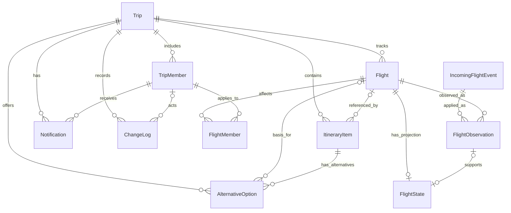

# 5. Модель данных

## 5.1. Границы и обозначения

Модель описывает поездку, наблюдения внешних источников, текущую проекцию статуса рейса и предложения изменить план. В v1 принятие предложения изменяет **только внутренний план**: бронирование, перебронирование, отмена и оплата системой не выполняются. Доступность и цена у внешнего поставщика могут измениться.

Ниже приведена логическая модель, а не готовая миграция БД. `uuid`, `varchar`, `date`, `integer`, `bigint`, `jsonb`, `timestamptz` — предлагаемые типы в стиле PostgreSQL. `timestamptz` представляет абсолютный момент; на границах API он передаётся в UTC с `Z`. `NULL: нет` означает обязательное значение. PK — первичный ключ, FK — внешний ключ, UQ — уникальность. Отсутствующие и неизвестные значения не подменяются вымышленными.

Для мониторинга достаточно идентификаторов рейса, даты и аэропортов; **паспортные данные не собираются и не используются**. Контакты, учётные записи и настройки каналов могут находиться в отдельном контуре и не показаны на диаграмме.

## 5.2. ER-диаграмма

[Открыть схему в полном размере](assets/diagrams/data-model.png)

`FlightMember` — самостоятельная связь рейса с теми участниками, к которым он относится; наличие участника в поездке само по себе не означает его участие в каждом рейсе. Запись `Flight` относится к одной поездке; одинаковый физический рейс в двух поездках может быть представлен двумя записями.

## 5.3. Словарь данных

### Trip — поездка

| Поле и тип | Назначение | NULL | Ключи и ограничения |
|---|---|---|---|
| `trip_id uuid` | Идентификатор поездки | нет | PK |
| `name varchar(200)` | Название поездки | нет | Непустое |
| `display_timezone varchar(64)` | Предпочитаемая зона отображения | нет | Допустимый идентификатор IANA, не смещение |
| `plan_version bigint` | Версия общего плана | нет | `>= 1`; увеличивается при каждом зафиксированном изменении плана |
| `last_sync_seq bigint` | Последний порядковый номер события синхронизации поездки | нет | `>= 0`; выделяется транзакционно, отдельно от версии плана |
| `created_at timestamptz` | Время создания | нет | UTC |

### TripMember — участник поездки

| Поле и тип | Назначение | NULL | Ключи и ограничения |
|---|---|---|---|
| `member_id uuid` | Идентификатор участия | нет | PK; UQ `(member_id, trip_id)` для составных FK |
| `trip_id uuid` | Поездка | нет | FK → `Trip.trip_id` |
| `user_id uuid` | Ссылка на учётную запись | нет | UQ `(trip_id, user_id)`; учётная запись вне диаграммы |
| `role varchar(16)` | Права в поездке | нет | `owner`, `editor`, `viewer`; правила прав согласовать |
| `membership_status varchar(16)` | Действующий или отозванный доступ | нет | `active`, `revoked`; права проверяются при каждом запросе |
| `notification_preferences jsonb` | Разрешённые каналы и настройки уведомлений | нет | Без паспортных данных и секретов; подписка не заменяет авторизацию |

### Flight — рейс в поездке

| Поле и тип | Назначение | NULL | Ключи и ограничения |
|---|---|---|---|
| `flight_id uuid` | Внутренний идентификатор рейса | нет | PK; UQ `(flight_id, trip_id)` для составных FK |
| `trip_id uuid` | Поездка | нет | FK → `Trip.trip_id` |
| `carrier_code varchar(8)` | Код перевозчика | нет | Нормализованный код, формат источника согласовать |
| `flight_number varchar(16)` | Номер рейса | нет | Непустой; не уникален без даты и контекста |
| `origin_airport varchar(8)` | Аэропорт вылета | нет | Код по принятому справочнику |
| `destination_airport varchar(8)` | Аэропорт прибытия | нет | Код по принятому справочнику |
| `scheduled_departure_local_date date` | **Исходная локальная дата вылета** для идентификации рейса | да | Нужна для мониторинга; не выводится из UTC-даты при неизвестной зоне |
| `scheduled_departure_local timestamp` | Исходное локальное время из источника | да | Без часового пояса; неизвестность зоны или неоднозначность явно сохраняются |
| `scheduled_departure_utc timestamptz` | Запланированный момент вылета | да | UTC; при известных местных дате и зоне должен им соответствовать |
| `departure_timezone varchar(64)` | Зона места вылета | да | Если известна — IANA, например `Europe/Paris`; не угадывается |
| `scheduled_arrival_utc timestamptz` | Запланированный момент прибытия | да | UTC; если известен, не раньше запланированного вылета |
| `arrival_timezone varchar(64)` | Зона места прибытия | да | Если известна — IANA; при отображении используется совместно с UTC |
| `create_request_key varchar(128)` | Идемпотентность создания записи рейса | нет | UQ `(trip_id, create_request_key)` |

Номер рейса, дата и аэропорты — кандидаты для поиска совпадения, но не универсальный уникальный ключ: возможны код-шеринг, изменения расписания и неоднозначные данные. Повтор с тем же `create_request_key` не создаёт второй записи; совпадения по бизнес-признакам требуют проверки, а не безусловного слияния. Неизвестные дата или зона допускаются в черновике, но мониторинг не запускается без обязательных для сопоставления данных; при нескольких совпадениях требуется выбор пользователя.

### FlightMember — принадлежность рейса участнику

| Поле и тип | Назначение | NULL | Ключи и ограничения |
|---|---|---|---|
| `flight_id uuid` | Рейс | нет | Составной FK `(flight_id, trip_id)` → `Flight` |
| `member_id uuid` | Участник, которого касается рейс | нет | Составной FK `(member_id, trip_id)` → `TripMember` |
| `trip_id uuid` | Общая поездка рейса и участника | нет | Обе ссылки должны указывать на одну поездку |
| `created_at timestamptz` | Время связывания | нет | UTC |

PK `(flight_id, member_id)` исключает повтор связи. Роли и каналы уведомлений определяются отдельно; принадлежность рейсу не даёт дополнительных прав.

### IncomingFlightEvent — реестр входных сообщений

| Поле и тип | Назначение | NULL | Ключи и ограничения |
|---|---|---|---|
| `incoming_event_id uuid` | Внутренний идентификатор события | нет | PK |
| `source_id varchar(80)` | Источник сообщения | нет | Из настроенного реестра |
| `source_event_id varchar(200)` | Нормализованный ID события в области источника | да | Частичный UQ `(source_id, source_event_id)` при известном ID |
| `fingerprint varchar(64)` | Хеш нормализованных существенных полей, если ID отсутствует | да | Частичный UQ `(source_id, fingerprint)` для событий без ID; правила канонизации согласуются по источнику |
| `payload_hash varchar(64)` | Хеш содержимого для выявления повторного ID с иными данными | нет | Несовпадение направляется на разбор |
| `received_at timestamptz` | Момент первого приёма системой | нет | UTC |

Одна запись реестра может породить по одному наблюдению для каждого связанного `Flight` в разных поездках. Если ID отсутствует, fingerprint — эвристика и не даёт абсолютной гарантии дедупликации. Если поставщик использует один ID для нескольких ревизий, адаптер нормализует составной ID в соответствии с его контрактом. Паспортные данные и сырой ответ источника в реестр не помещаются.

### FlightObservation — полученное наблюдение

| Поле и тип | Назначение | NULL | Ключи и ограничения |
|---|---|---|---|
| `observation_id uuid` | Идентификатор наблюдения | нет | PK; UQ `(observation_id, flight_id)` |
| `flight_id uuid` | Рейс | нет | FK → `Flight.flight_id` |
| `incoming_event_id uuid` | Полученное входное событие | нет | FK → `IncomingFlightEvent`; UQ `(incoming_event_id, flight_id)` |
| `source_id varchar(80)` | Идентификатор внешнего источника | нет | Источник из настроенного реестра |
| `source_event_id varchar(200)` | Идентификатор события поставщика | да | Наличие и область уникальности зависят от контракта API |
| `source_event_version varchar(128)` | Версия в пределах потока источника | да | Сравнивается только при подтверждённой сопоставимости |
| `source_event_at timestamptz` | Момент изменения по данным источника | да | UTC; неизвестный момент не приравнивается ко времени получения |
| `source_as_of timestamptz` | Момент, на который источник подтверждает значение | да | UTC; не приравнивается к времени получения без оснований |
| `received_at timestamptz` | Первое получение системой | нет | UTC |
| `normalized_status varchar(20)` | Нормализованный фактический статус из наблюдения | нет | `unknown`, `scheduled`, `delayed`, `boarding`, `departed`, `arrived`, `cancelled` |
| `expected_departure_utc timestamptz` | Ожидаемый вылет по наблюдению | да | UTC |
| `expected_arrival_utc timestamptz` | Ожидаемое прибытие по наблюдению | да | UTC |

Входное сообщение дедуплицируется в `IncomingFlightEvent`; его применение к конкретному рейсу — по `(incoming_event_id, flight_id)`. Повторное идентичное сообщение не создаёт нового наблюдения для того же рейса; успешная повторная проверка может отдельно обновить `last_checked_at`, только если действительно подтверждает текущее значение. Один и тот же ключ с другим содержимым направляется на разбор как конфликт, а не молча отбрасывается. Если у источника нет надёжного времени или версии, нельзя считать более позднее получение доказательством более нового факта.

### FlightState — текущая проекция рейса

| Поле и тип | Назначение | NULL | Ключи и ограничения |
|---|---|---|---|
| `flight_id uuid` | Рейс | нет | PK и FK → `Flight.flight_id`; не более одной проекции на рейс |
| `state_version bigint` | Версия значимых данных проекции | нет | `>= 1`; увеличивается при значимом изменении состояния |
| `current_status varchar(20)` | Последний подтверждённый фактический статус | нет | Те же значения, что у `normalized_status`; при отсутствии фактов — `unknown` |
| `last_observation_id uuid` | Наблюдение, на котором основана проекция | да | Составной FK `(last_observation_id, flight_id)` → `FlightObservation` того же рейса |
| `last_checked_at timestamptz` | Последняя успешная проверка источника текущей проекции | да | UTC; ошибка/тайм-аут или ответ, не подтверждающий проекцию, не обновляют поле |
| `status_source_event_at timestamptz` | Время события источника для текущего статуса | да | UTC; не заменяется временем получения |
| `status_source_as_of timestamptz` | Надёжный момент подтверждения текущего статуса источником | да | UTC; неизвестное значение не заменяется временем получения |
| `verification_state varchar(20)` | Достаточность подтверждения | нет | `confirmed`, `needs_review`, `unknown`; конфликт источников может требовать проверки |
| `expected_departure_utc timestamptz` | Текущая ожидаемая оценка вылета | да | UTC; не является гарантией |
| `expected_arrival_utc timestamptz` | Текущая ожидаемая оценка прибытия | да | UTC; не является гарантией |

**Свежесть — отдельная характеристика, а не статус рейса.** Для отображения `freshness` вычисляется как `fresh`, `stale` или `unknown` с учётом успешной проверки, надёжного `status_source_as_of` и согласованного порога источника. Без надёжного подтверждения или без утверждённой политики свежесть `unknown`, а пользователь видит, что она не установлена. Повтор старого сообщения не подтверждает текущий статус и не продлевает свежесть. Сохранённый статус при устаревании не превращается в `DataStale` и не стирается. Свежая проверка не устраняет автоматически конфликт источников: `verification_state` оценивается отдельно, конкурирующие значения и их источники показываются по правам. Порядок и приоритет источников нужно согласовать; неподтверждённое старое событие не должно откатывать подтверждённый новый статус.

### ItineraryItem — элемент плана

| Поле и тип | Назначение | NULL | Ключи и ограничения |
|---|---|---|---|
| `item_id uuid` | Идентификатор элемента | нет | PK; UQ `(item_id, trip_id)` |
| `trip_id uuid` | Поездка | нет | FK → `Trip.trip_id` |
| `flight_id uuid` | Связанный рейс, если применимо | да | Составной FK `(flight_id, trip_id)` → `Flight` той же поездки |
| `item_type varchar(20)` | Тип элемента | нет | Например, `flight`, `hotel`, `transfer`, `activity` |
| `title varchar(200)` | Название для плана | нет | Непустое; не предназначено для документов или секретов |
| `start_local timestamp` | Исходное местное время начала, если известно | да | Без часового пояса; при неоднозначности UTC-момент не угадывается |
| `start_utc timestamptz` | Момент начала | да | UTC, если известен |
| `end_utc timestamptz` | Момент окончания | да | UTC; если оба момента известны, `end_utc >= start_utc` |
| `timezone_id varchar(64)` | Зона места события | да | IANA, если известна; неизвестная зона явно обозначается |
| `item_status varchar(20)` | Состояние элемента внутреннего плана | нет | Допустимые значения согласовать; не отражает автоматически состояние бронирования |

### AlternativeOption — предложение

| Поле и тип | Назначение | NULL | Ключи и ограничения |
|---|---|---|---|
| `option_id uuid` | Идентификатор предложения | нет | PK; UQ `(option_id, trip_id)` |
| `trip_id uuid` | Поездка | нет | FK → `Trip.trip_id` |
| `item_id uuid` | Конкретный заменяемый элемент плана | нет | Составной FK `(item_id, trip_id)` → `ItineraryItem` той же поездки |
| `flight_id uuid` | Исходный затронутый рейс, если вариант относится к рейсу | да | Составной FK `(flight_id, trip_id)` → `Flight` той же поездки; для активности может быть `NULL` |
| `option_version bigint` | Версия содержимого и сохранённого состояния предложения | нет | `>= 1`; увеличивается при изменении предложения |
| `base_plan_version bigint` | Версия плана, для которой рассчитан вариант | нет | `>= 1`; проверяется при принятии |
| `basis_state_version bigint` | Версия значимых данных исходного рейса | да | Для варианта рейса проверяется вместе с текущим `FlightState.state_version` |
| `status varchar(16)` | Состояние предложения | нет | `proposed`, `accepted`, `rejected`, `expired`, `stale` |
| `source_id varchar(80)` | Источник данных о варианте | нет | Идентификатор источника |
| `fetched_at timestamptz` | Время получения данных о варианте | нет | UTC |
| `valid_until timestamptz` | Верхняя граница действия предложения | да | UTC; без срока принятие запрещено, иначе текущий момент должен быть раньше `valid_until` |
| `details jsonb` | Маршрут, ограничения, цена/валюта и предупреждения, если известны | нет | Без паспортных данных; цена и наличие не гарантируются |

`valid_until` задаётся по политике продукта и доступным условиям источника. Если установить приемлемый срок нельзя, вариант с `NULL` может быть сохранён и показан только справочно, но не принимается до проверки и назначения срока. Для варианта рейса ссылка `flight_id` должна соответствовать рейсу заменяемого элемента; для альтернативы активности она отсутствует. Если необходимая версия состояния рейса неизвестна, вариант остаётся справочным до проверки. API может передавать `option_version` как непрозрачную строковую ревизию `option_revision`. При изменении цены, наличия или условий предложение необходимо перепроверить и при необходимости перевыпустить/пометить устаревшим. Истечение срока может определяться вычисляемо до фонового обновления `status`.

### Notification — адресное уведомление

| Поле и тип | Назначение | NULL | Ключи и ограничения |
|---|---|---|---|
| `notification_id uuid` | Идентификатор уведомления | нет | PK |
| `trip_id uuid` | Поездка | нет | FK → `Trip.trip_id` |
| `member_id uuid` | Получатель | нет | Составной FK `(member_id, trip_id)` → `TripMember` той же поездки |
| `event_key varchar(256)` | Стабильный ключ изменения и причины уведомления | нет | UQ `(trip_id, member_id, channel, event_key)`; формируется из `change_id` и `reason` |
| `channel varchar(16)` | Канал | нет | Например, `push`, `email`, `sms`; фактические каналы согласовать |
| `delivery_status varchar(20)` | Известный системе этап доставки | нет | Например, `pending`, `sent`, `delivered`, `failed`, `unknown`; квитанция зависит от канала |
| `created_at timestamptz` | Создание уведомления | нет | UTC |
| `last_attempt_at timestamptz` | Последняя попытка отправки | да | UTC |
| `provider_message_id varchar(200)` | ID сообщения внешнего канала | да | Не служит единственным ключом дедупликации |

Статус `sent` означает передачу каналу, а не прочтение. `delivered` допустим только при получении соответствующей квитанции; реальное получение и прочтение не гарантируются.

### ChangeLog — журнал изменений для истории и синхронизации

| Поле и тип | Назначение | NULL | Ключи и ограничения |
|---|---|---|---|
| `change_id uuid` | Идентификатор изменения | нет | PK |
| `trip_id uuid` | Поездка | нет | FK → `Trip.trip_id` |
| `sync_seq bigint` | Порядок изменения внутри поездки | нет | UQ `(trip_id, sync_seq)`; транзакционно выделяется через `Trip.last_sync_seq` |
| `actor_member_id uuid` | Автор; `NULL` для системного изменения | да | Составной FK `(actor_member_id, trip_id)` → `TripMember` той же поездки |
| `change_kind varchar(20)` | Тип синхронизируемого изменения | нет | `plan`, `projection`, `other_sync` |
| `object_type varchar(40)` | Тип изменённого объекта | нет | Согласованный каталог типов |
| `object_id uuid` | Идентификатор изменённого объекта | нет | Ссылка проверяется по типу и области доступа |
| `operation varchar(10)` | Изменение или удаление объекта | нет | `upsert` или `delete`; удаление передаётся как минимальный маркер |
| `action varchar(40)` | Тип действия | нет | Согласованный каталог действий |
| `version_before bigint` | Версия плана до изменения | нет | `>= 1` |
| `version_after bigint` | Версия плана после изменения | нет | Для `plan`: `version_after = version_before + 1`, частичный UQ `(trip_id, version_after)` для `plan`; иначе версии равны |
| `changed_at timestamptz` | Время фиксации | нет | UTC |
| `change_summary jsonb` | Минимальное описание изменения | нет | Без паспортных данных, токенов и платёжных реквизитов |

Журнал синхронизации не заменяет отдельный защищённый журнал событий безопасности и доступа. Номер `sync_seq` выделяется при блокировке строки поездки и фиксируется вместе с изменением, обеспечивая порядок коммитов внутри поездки. Изменения проекций и иных синхронизируемых объектов включаются в delta, но сами по себе не увеличивают `plan_version`; если на их основании меняется сам план, версия и история обновляются в той же транзакции. Непрозрачный токен клиента не равен `plan_version`.

## 5.4. Время и пересадки

Хранить абсолютные моменты в UTC, а зоны мест событий — как идентификаторы IANA; учитывать правила зоны на соответствующую дату, в том числе переходы летнего времени. Для неоднозначного локального времени источник должен предоставить достаточно данных для определения момента; иначе значение остаётся неподтверждённым. Исходную локальную дату вылета сохранять отдельно даже при пересечении полуночи UTC.

Пример: прибытие в Париж **2027-06-15 10:20Z**, то есть **12:20 Europe/Paris**; следующий вылет **2027-06-15 11:50Z**, то есть **13:50 Europe/Paris**. Разница между моментами UTC — **90 минут**. Это только имеющийся интервал, а не подтверждение достижимости: требуется проверить минимальное время пересадки, терминалы, багаж, смену аэропорта и другие известные ограничения. Локальные строки сами по себе не используются для расчёта.

## 5.5. Принятие и конкурентные изменения

1. Клиент передаёт `option_id`, наблюдавшиеся `option_version` и `plan_version`, а также ключ идемпотентности запроса. Сервер проверяет действующую роль и допустимость влияния на затронутых участников. Ключ связывается с автором и хешем запроса; повтор с изменённым содержимым отклоняется. После проверки прав успешный идентичный повтор возвращает сохранённый результат до проверки текущего срока и версий, в том числе если предложение уже истекло.
2. При необходимости источник перепроверяется до короткой транзакции; если проверка обязательна, но недоступна, принятие не выполняется. После блокировки записей в одной транзакции повторно проверяются `status = proposed`, наличие `valid_until` и текущий момент ранее него, свежесть обязательной перепроверки, версия значимых данных рейса и совпадение версии предложения и плана с переданными значениями, включая `base_plan_version`. В PostgreSQL для проверки текущего времени использовать, например, `clock_timestamp()`, а не время начала транзакции. Проверка источника не гарантирует неизменность внешних условий после неё.
3. При успехе меняются только указанный `item_id` во внутреннем плане и состояние предложения; увеличиваются `option_version` и `plan_version`, записываются `ChangeLog` и событие в транзакционный outbox. Авторизованный повтор идентичного запроса с тем же ключом возвращает прежний результат, не применяя изменение дважды.
4. При истёкшем сроке, изменённой версии или отзыве прав план не меняется: клиент получает отказ/конфликт и должен обновить данные. Принятие не подтверждает наличие места, бронирование, оплату или изменение внешних заказов.

## 5.6. Допущения и открытые вопросы

**Принятые допущения:** у рейса и участника общая поездка; одна проекция состояния приходится максимум на один рейс; временные метки хранятся в UTC; адресат уведомления — участник поездки; предложение в v1 не вызывает действий у перевозчика.

**Требуют решения:** поставщики и правила сопоставления рейсов/код-шеринга; область уникальности внешних событий и алгоритмы сравнения конфликтующих источников; пороги свежести и сроки действия вариантов; точные права на изменение группового плана; обязательность повторной проверки перед принятием; структура деталей альтернатив и статусы элементов; политика хранения и удаления данных с учётом применимых требований.
